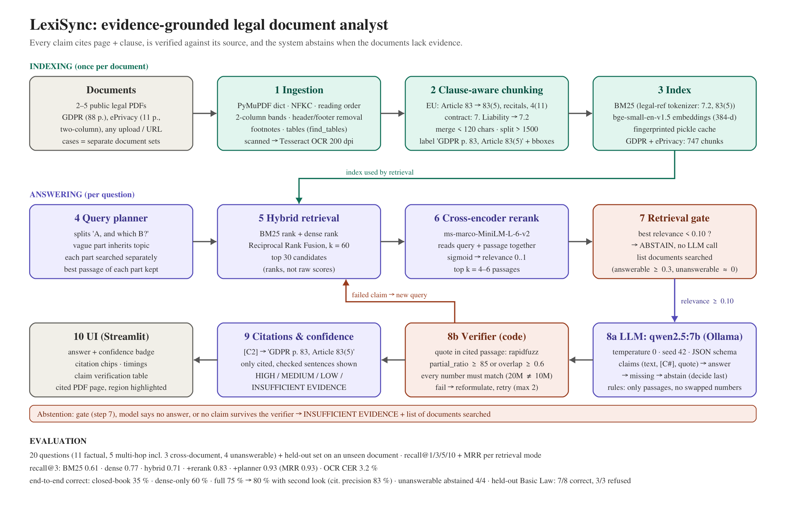
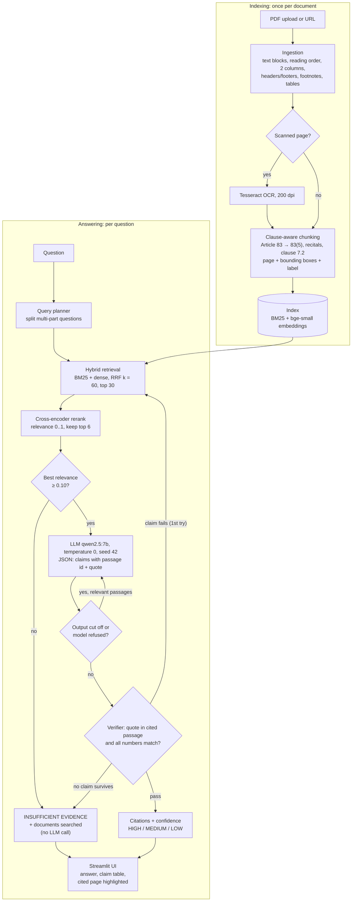

# LexiSync — evidence-grounded legal document analyst

LexiSync answers questions about a set of legal PDFs (regulations, contracts, constitutions).
Every claim in an answer cites the **document, page and clause** it comes from
(e.g. `GDPR p. 83, Article 83(5)`), the cited page is shown with the **cited region
highlighted**, and the system **abstains** ("INSUFFICIENT EVIDENCE") when the documents do not
contain the answer. It runs fully locally: open-weight models, no paid API.



A printable one-page version of the diagram is in [docs/architecture.pdf](docs/architecture.pdf).

## What it does

1. Create a **case** (a separate set of documents) and add legal PDFs by upload or URL.
2. The **Documents & structure** tab shows what was detected in each PDF: pages, articles and
   recitals, two-column pages, tables, footnotes, removed headers, scanned (OCR) pages.
3. Ask a question, e.g. *"Under the GDPR, what is the maximum fine a company can receive, and
   which kinds of violations trigger the higher fine?"*
4. The answer cites every claim as `document p. page, clause` (e.g. `GDPR p. 83, Article 83(5)`),
   shows a confidence badge (HIGH / MEDIUM / LOW), a table of verified claims with their quotes,
   and the cited PDF page with the cited region highlighted.
5. If the documents do not contain the answer (*"What is the speed limit on German motorways?"*),
   it answers **INSUFFICIENT EVIDENCE** and lists the documents it searched.

## Flowchart



## How it works

| Stage | What happens | File |
|---|---|---|
| **Ingestion** | PyMuPDF reads text blocks with their font size and position. Text is normalised (NFKC), two-column pages are read column by column, running headers/footers (repeated on ≥ 40 % of pages) and footnotes (small font near the bottom) are removed from the main text, tables are converted to Markdown, and pages with almost no text but a large image are sent to Tesseract OCR. A structure report lists everything detected, per page. | `lexisync/ingest.py` |
| **Chunking** | Chunks follow the legal structure instead of a fixed size: recitals, articles and their paragraphs (`83(5)`), definitions (`4(11)`), contract clauses (`7`, `7.2`). Pieces under 120 characters are merged within the same clause; pieces over 1500 are split at points (a), (b) with the lead-in sentence kept. Each chunk stores its pages, bounding boxes and a citation label. | `lexisync/chunking.py` |
| **Retrieval** | BM25 with a tokenizer that keeps legal references (`7.2`, `83(5)(a)`) whole, plus dense embeddings (`BAAI/bge-small-en-v1.5`). The two rankings are fused with Reciprocal Rank Fusion (k = 60); the top 30 are reranked by a cross-encoder (`ms-marco-MiniLM-L-6-v2`) that reads question and passage together. A query planner splits "A, and which B?" questions so each part gets its own best passage. The index is cached on disk. | `lexisync/retrieve.py`, `lexisync/embed.py` |
| **Abstention gate** | If the best rerank relevance is below 0.10, the system answers INSUFFICIENT EVIDENCE immediately, without calling the LLM. | `lexisync/answer.py` |
| **Generation** | A local LLM (`qwen2.5:7b` via Ollama, temperature 0, seed 42) sees only the numbered passages and returns JSON: claims (each with a passage id and a verbatim quote), the answer, missing parts, an abstain flag and an explanation. An OpenAI-compatible API or a scripted mock can be used instead. | `lexisync/llm.py`, `lexisync/answer.py` |
| **Verification** | Code — not the LLM — checks every claim: the quote must occur in the cited passage (rapidfuzz `partial_ratio` ≥ 85 or word overlap ≥ 0.6) and every number must match. A failed claim triggers one reformulated search and a second attempt; claims that still fail are dropped. If the output was cut off at the token limit, complete claims are kept and the model is asked for a shorter answer. Only cited, verified sentences are shown. | `lexisync/answer.py` |
| **Confidence** | HIGH (relevance ≥ 0.70, nothing dropped or missing), MEDIUM, LOW (relevance < 0.30 or most claims dropped), or INSUFFICIENT EVIDENCE. | `lexisync/answer.py` |
| **UI** | Streamlit with three tabs: **Ask** (answer, citation chips, confidence, timings and tokens, claim table, retrieved passages, cited page with highlighted region), **Documents & structure** (upload/URL, re-index, structure report) and **Evaluation** (results from `reports/`). | `app.py`, `lexisync/render.py` |
| **Evaluation** | Retrieval recall@1/3/5/10 and MRR for five retrieval modes; end-to-end correctness, citation precision, abstention accuracy, false abstention, latency and tokens for six configurations; a held-out test on an unseen document; an OCR accuracy benchmark. | `eval/run_eval.py`, `scripts/ocr_benchmark.py` |
| **Engineering** | Pinned requirements, `config.yaml` (seed 42), Makefile, Dockerfile + docker-compose (app + Ollama), GitHub Actions CI, 90 offline tests. | `Makefile`, `Dockerfile`, `.github/workflows/ci.yml`, `tests/` |

## Quickstart (macOS / Linux)

Requirements: Python 3.12+, [Tesseract](https://github.com/tesseract-ocr/tesseract)
(`brew install tesseract` / `apt install tesseract-ocr`) and [Ollama](https://ollama.com).

```bash
python3 -m venv .venv && source .venv/bin/activate
make setup          # pinned dependencies
make model          # embedding + reranker models, and `ollama pull qwen2.5:7b`
make docs           # GDPR + ePrivacy into data/docs (EUR-Lex may require a browser download)
make test           # unit tests
make app            # http://localhost:8501
```

Command line:

```bash
make structure                    # what ingestion found in each PDF
make index                        # build the cached search index
make ask Q="What are the maximum fines under the GDPR?"      # compare retrieval modes
make answer Q="What are the maximum fines under the GDPR?"   # full pipeline
make eval                          # full evaluation -> reports/main/report.md
make heldout                       # held-out document in data/heldout
make ocr                           # OCR accuracy benchmark
make help                          # every target
```

### Docker

```bash
make docker      # = docker compose up --build ; app on http://localhost:8501
docker compose exec ollama ollama pull qwen2.5:7b    # first time only
```

The app container talks to the Ollama container through `OLLAMA_HOST_URL`.

## Configuration

Everything tunable is in [`config.yaml`](config.yaml): seed, ingestion thresholds, models,
BM25 and RRF parameters, `top_k`, the abstention threshold, verifier thresholds and the
LLM backend (`ollama`, an OpenAI-compatible server, or `mock`). Environment overrides:
`LEXISYNC_OFFLINE=1` (small stand-in models for tests), `LEXISYNC_LLM=mock`,
`OLLAMA_HOST_URL`, `LEXISYNC_CASES`, `LEXISYNC_REPORTS`.

## Results

Corpus: GDPR (88 pages) and the ePrivacy Directive (11 pages, two-column) → 747 chunks;
structure check found 99/99 GDPR articles, 173/173 recitals, 21/21 ePrivacy articles and
49/49 recitals. Test set `eval/questions.jsonl`: 20 questions written and verified by hand —
11 factual, 5 multi-hop (3 across both documents), 4 unanswerable.

**Retrieval** (paragraph-level gold passages, 16 answerable questions):

| mode | R@1 | R@3 | R@5 | R@10 | MRR |
|---|---|---|---|---|---|
| BM25 | 0.52 | 0.61 | 0.77 | 0.89 | 0.76 |
| dense (bge-small) | 0.53 | 0.77 | 0.83 | 0.93 | 0.76 |
| hybrid (RRF) | 0.44 | 0.71 | 0.93 | 0.95 | 0.68 |
| hybrid + rerank | 0.62 | 0.83 | 0.86 | 0.92 | 0.83 |
| hybrid + rerank + planner | **0.71** | **0.93** | **0.93** | 0.93 | **0.93** |

Abstention gate: at every threshold from 0.01 to 0.30, 4/4 unanswerable questions abstained
and 0/16 answerable questions were wrongly abstained (chosen threshold 0.10).

**End-to-end** (20 questions, qwen2.5:7b, automatic key-fact scoring):

| configuration | correct | citation precision | abstention accuracy (4 unanswerable) | false abstention (16 answerable) | latency |
|---|---|---|---|---|---|
| closed-book LLM (no retrieval) | 35 % | – | 75 % | 44 % | 16 s |
| dense retrieval only | 60 % | 76 % | 100 % | 19 % | 33 s |
| full system (hybrid + rerank + planner + verifier, k = 6) | **75 %** | **82 %** | **100 %** | 12 % | 28 s |
| full without planner | 70 % | 76 % | 100 % | 12 % | 31 s |
| full without verifier | 75 % | 75 % | 100 % | 6 % | 24 s |
| full with k = 4 | 70 % | 81 % | 100 % | 25 % | 29 s |
| full + second look | 80 % | 83 % | 100 % | 6 % | 32 s |
| **final (+ cut-off handling)** | **85 %** | 79 % | **100 %** | **0 %** | **28 s** |

What this shows:
- **Retrieval is essential**: without documents the model is right 35 % of the time and
  invented an answer for one unanswerable question; with the full pipeline 75 % and no
  invented answers. The four unanswerable questions are stopped by the gate in ~0.3 s,
  without an LLM call.
- **Hybrid + rerank beats dense alone** (75 % vs 60 %), and the **planner** adds 5 points of
  correctness and 6 points of citation precision.
- **The verifier raises citation precision** (75 % → 82 %) at the same correctness: it
  removes claims whose quote or numbers are not in the cited passage.
- **Error analysis of the wrong refusals** (f02 lower fine tier, f04 definition of consent):
  retrieval had found the right passages, yet the result was "the model found no answer".
  A first fix (a **second look** when the model refuses although relevance ≥ 0.30) gave
  75 % → 80 %. The real root cause showed up later in the UI: the token counter read exactly
  2 × 1024 — the model's JSON was **cut off at the output-token limit**, and invalid JSON had
  been treated as a refusal. Final fix: detect truncation, keep every complete claim written
  before the cut (claims come first in the JSON, and they are still verified), ask for a
  shorter answer if nothing survived, add a brevity rule to the prompt, and report the true
  reason. **Final result: 85 % correct, 16/16 answerable questions answered (0 % false
  abstention), 4/4 unanswerable refused, 28 s average.** Citation precision moved from
  83 % to 79 % because more questions are now answered and some answers also cite a
  neighbouring article. Because these fixes were motivated by test-set errors, the
  held-out document is the honest check (`reports/main` = before, `reports/fix` = second
  look, `reports/final` = final).
- **k = 6 beats k = 4**: with only 4 passages two multi-hop questions lost evidence
  (false abstention 25 %).
- Full report: `reports/main/report.md`; manual grades go in the `manual_correct` column of
  `reports/main/answers.csv` (then `python eval/run_eval.py --summary-only`).

**Held-out test** (run once after all tuning, nothing changed afterwards): the German Basic
Law (English translation, a document type never used during development, 631 chunks),
8 questions in `eval/heldout.jsonl` — 4 factual, 1 multi-hop, 3 unanswerable.

| | result |
|---|---|
| retrieval recall@3 (hybrid + rerank) | 1.00 (MRR 0.90; BM25 alone 0.70) |
| correct answers | 88 % (7/8) |
| citation precision | 80 % |
| unanswerable refused | 3/3 (2 by the gate, 1 by the model) |
| answerable wrongly refused | 0/5 |
| average latency | 10 s |

The one error (h02, "from what age can people vote?") is instructive: retrieval had the
right passage (Article 38(2), age 18) in the top 3, but the model cited Article 54(1)
(election of the Federal President, age 40), which contains the exact phrase "entitled to
vote in Bundestag elections". The verifier passed it because the quote *is* in that
passage: it checks that a claim is supported by its citation, not that the citation answers
the question. As agreed for a held-out test, this was not tuned away.

**OCR** (synthetic scanned pages with known text, 200 dpi): mean character error rate 3.2 %,
word error rate 3.5 %; clause-number recall on the hardest page improved from 12 % to 88 %
by running two Tesseract page-segmentation modes and keeping the one that finds more
clause numbers.

## Limitations (honest)

- A 7B local model sometimes leaves out one part of a long multi-part answer (e.g. the second
  fine tier of Article 83); the verifier guarantees what *is* shown is supported, not that
  everything relevant is shown. Missing parts are listed under "missing".
- Answers are slow on a laptop CPU/GPU (15–40 s per question; ~80 s with a retry).
- Tables and scanned pages are handled, but complex nested tables and poor scans lose
  structure; OCR text keeps page-level, not word-perfect, highlighting.
- The abstention threshold was chosen on our own question set; on the held-out document it
  still refused 3/3 unanswerable and 0/5 answerable questions.
- The verifier proves a claim is *in* the cited passage, not that the passage answers the
  question (held-out h02: a quote about the President's minimum age answered a voting-age
  question).
- This is a reading aid, not legal advice.

## Project layout

```
lexisync/      models, ingest, chunking, embed, retrieve, llm, answer, pipeline, render
app.py         Streamlit UI
eval/          questions.jsonl, heldout.jsonl, run_eval.py
scripts/       download_docs, make_synthetic_pdfs, build_index, ocr_benchmark, make_architecture
tests/         pytest suite (offline models + mock LLM)
docs/          architecture diagram (PNG/PDF/SVG + Mermaid), exam notes
reports/       evaluation outputs
```
